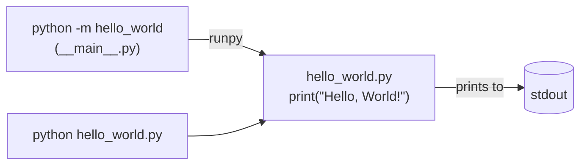

<div align="center">

# 🌍 Hello World

**A robust, production-ready Hello World application for Python.**

[](https://github.com/Lomchat/HelloWorld/actions/workflows/ci.yml)
[](docs/testing-strategy.md)
[](tests/)
[](pyproject.toml)
[](https://mypy.readthedocs.io/)
[](https://github.com/astral-sh/ruff)
[](pyproject.toml)
[](LICENSE)

[Features](#-features) •
[Quick Start](#-quick-start) •
[Implementation](#-implementation) •
[Architecture](#️-architecture) •
[Testing](#-testing) •
[FAQ](#-faq)

</div>

---

## 📖 Overview

**Hello World** is a modern, production-grade implementation of the canonical
"Hello, World!" program. Built on clean code principles, it provides a solid,
battle-tested foundation for greeting the world reliably, securely and
consistently, on every platform.

```console
$ python -m hello_world
Hello, World!
```

## ✨ Features

- 🎯 **Minimal by Design**: the entire implementation is a single statement ([ADR-0009](docs/adr/0009-reduce-the-implementation-to-a-single-statement.md)).
- 📝 **Thoroughly Documented**: every design decision is explained in the comments surrounding the implementation (76 lines of comments).
- 🧪 **Thoroughly Tested**: 429 tests across 9 categories, 100% line and branch coverage.
- 🛡️ **Secure by Design**: output verified against 22 terminal injection vectors and every control character.
- 🔒 **Hermetic**: output is guaranteed to be independent of locale, terminal settings, environment variables and command-line arguments.
- 🔍 **Fully Typed**: passes `mypy --strict` and ships a `py.typed` marker.
- ⚡ **Fast**: constant time, O(1), with performance budgets enforced in CI.
- 🧵 **Thread-Safe**: stateless by construction. No variable, no function, no class.
- 📦 **Zero Dependencies**: not a single import.
- 🐳 **Container Ready**: multi-stage, non-root Docker image with a health check.
- 📚 **Documented Decisions**: every design choice is recorded in one of 9 [ADRs](docs/adr/).

## 🚀 Quick Start

### Requirements

- Python 3.10 or later

### Installation

```bash
pip install git+https://github.com/Lomchat/HelloWorld.git
```

Or from source:

```bash
git clone https://github.com/Lomchat/HelloWorld.git
cd HelloWorld
make install
```

### Usage

```console
$ python -m hello_world
Hello, World!
```

The core module can also be run directly as a script:

```console
$ python src/hello_world/hello_world.py
Hello, World!
```

### Docker

```bash
docker build -t hello-world .
docker run --rm hello-world
```

## 🔬 Implementation

The entire implementation of the application fits in a single statement,
located in [`src/hello_world/hello_world.py`](src/hello_world/hello_world.py):

```python
print("Hello, World!")
```

It is surrounded by 76 lines of comments documenting its overview, execution
model, design principles, output contract, security considerations, error
handling, performance and maintenance notes. A module docstring is
deliberately not used, as it would count as a second statement.

### Exit codes

| Code | Meaning                     |
| ---- | --------------------------- |
| `0`  | The greeting was printed.   |

## 🏗️ Architecture

Hello World follows a deliberately simple, single-module architecture
([ADR-0004](docs/adr/0004-single-module-layout.md)), reduced to a single
statement ([ADR-0009](docs/adr/0009-reduce-the-implementation-to-a-single-statement.md)).



See [docs/architecture.md](docs/architecture.md) for a detailed walkthrough and
[docs/adr/](docs/adr/) for the reasoning behind each design decision.

## 📁 Project Structure

```text
HelloWorld/
├── src/hello_world/
│   ├── __init__.py          # Package metadata (version)
│   ├── __main__.py          # `python -m hello_world` entry point
│   ├── hello_world.py       # Core implementation (1 statement)
│   └── py.typed             # PEP 561 marker
├── tests/                   # 429 tests (see below)
├── benchmarks/              # Micro-benchmarks
├── docs/
│   ├── adr/                 # Architecture Decision Records
│   ├── migration/           # Migration guides
│   ├── architecture.md
│   └── testing-strategy.md
├── scripts/                 # Maintenance scripts
├── .claude/                 # Claude Code configuration
└── .github/                 # CI/CD workflows and templates
```

## 🧪 Testing

```bash
make test        # run the full test suite
make coverage    # run with coverage (fails under 100%)
make check       # lint + typecheck + tests, as in CI
```

| Category       | Location             | Tests   | Purpose                                              |
| -------------- | -------------------- | ------: | ---------------------------------------------------- |
| Security       | `tests/security/`    |     177 | Terminal injection and environment isolation         |
| Conformance    | `tests/conformance/` |     127 | Byte-exact output contract through every entry point |
| Unit           | `tests/unit/`        |      77 | Behavior and structure of the core module            |
| End-to-end     | `tests/e2e/`         |      19 | Real executable in a subprocess                      |
| Regression     | `tests/regression/`  |      11 | Previously fixed bugs                                |
| Integration    | `tests/integration/` |       7 | Entry points, in-process                             |
| Property-based | `tests/property/`    |       5 | Invariants under generated conditions                |
| Performance    | `tests/performance/` |       3 | Latency budgets                                      |
| Concurrency    | `tests/concurrency/` |       3 | Thread and process safety                            |
| **Total**      |                      | **429** |                                                      |

The full suite runs in about 2 seconds. Run a single category with its
marker, e.g. `pytest -m security`. See
[docs/testing-strategy.md](docs/testing-strategy.md) for details.

## 🗺️ Roadmap

- [x] Core greeting engine
- [x] `python -m` support
- [x] Security and conformance test suites
- [x] 100% test coverage
- [x] Docker image
- [x] Reduce the implementation to a single statement
- [ ] Internationalization (see [ADR-0005](docs/adr/0005-defer-internationalization.md))

## ❓ FAQ

<details>
<summary><b>Why not simply use <code>print("Hello, World!")</code>?</b></summary>

As of version 3.0.0, it does. The full rationale is available in
[ADR-0009](docs/adr/0009-reduce-the-implementation-to-a-single-statement.md),
and the history of the previous design in
[ADR-0003](docs/adr/0003-separate-greeting-composition-from-output.md).

</details>

<details>
<summary><b>Why are there so many comments for a single line of code?</b></summary>

Every design decision affecting the implementation is documented next to it,
where maintainers are most likely to read it. A module docstring would have
been more idiomatic, but it would count as a second statement, which would
violate ADR-0009.

</details>

<details>
<summary><b>Where did <code>greet()</code>, <code>main()</code> and <code>GREETING</code> go?</b></summary>

They were removed in version 3.0.0, as no consumer of the Python API was ever
identified. See the [migration guide](docs/migration/v2-to-v3.md).

</details>

<details>
<summary><b>Why does <code>python -m hello_world --help</code> print the greeting?</b></summary>

The application takes no arguments by design: command-line arguments are
ignored, and the output is always the canonical greeting. This behavior is
covered by the end-to-end and property-based test suites.

</details>

<details>
<summary><b>Does it support other languages?</b></summary>

Not yet. Internationalization has been carefully evaluated and deliberately
deferred. See [ADR-0005](docs/adr/0005-defer-internationalization.md).

</details>

<details>
<summary><b>Is it thread-safe?</b></summary>

Yes. The implementation defines no variable, no function and no class: it has
no state that could be shared between threads. Thread safety is nevertheless
covered by a dedicated test suite.

</details>

## 🤝 Contributing

Contributions are welcome! Please read [CONTRIBUTING.md](CONTRIBUTING.md) and
our [Code of Conduct](CODE_OF_CONDUCT.md) before opening a pull request.

To report a vulnerability, please follow [SECURITY.md](SECURITY.md) instead of
opening a public issue.

## 📄 License

Distributed under the MIT License. See [LICENSE](LICENSE) for details.

## 🙏 Acknowledgments

- Brian Kernighan, for the original `hello, world` example (1972).
- The Python community and the maintainers of pytest, Hypothesis, Ruff and mypy.
- All our [contributors](https://github.com/Lomchat/HelloWorld/graphs/contributors).

<div align="center">

Made with ❤️ by the Hello World team

</div>
