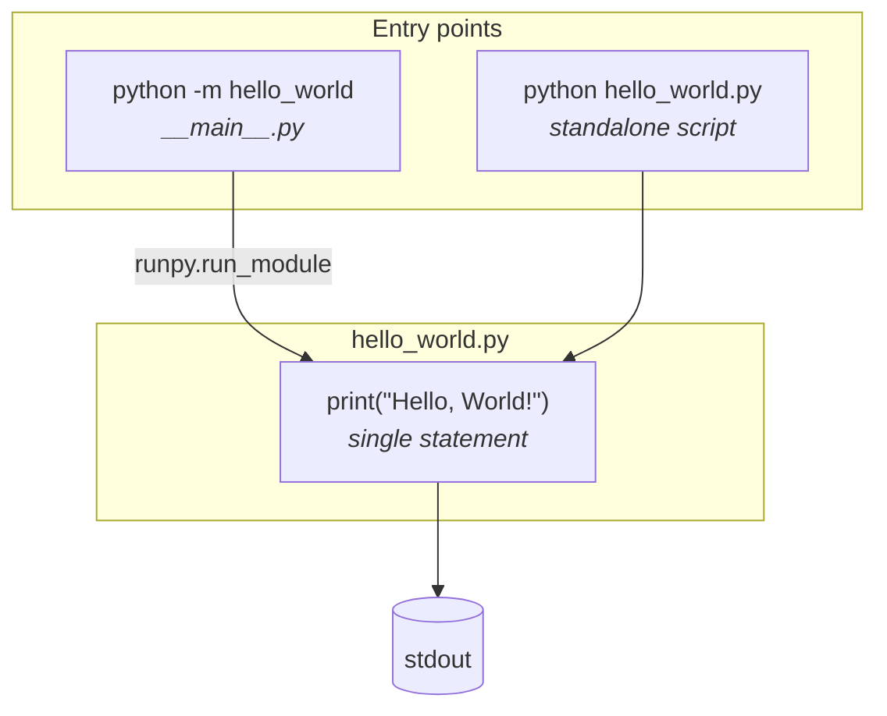
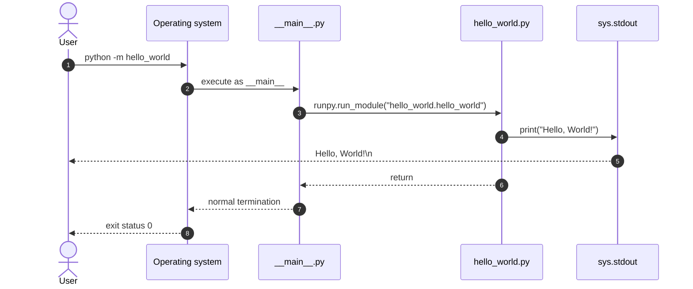

# Architecture

This document describes the architecture of the hello-world application. For the reasoning behind each decision, see the [Architecture Decision Records](adr/).

## Overview

The entire implementation of Hello World is a single statement, located in `src/hello_world/hello_world.py` ([ADR-0009](adr/0009-reduce-the-implementation-to-a-single-statement.md)):

```python
print("Hello, World!")
```

The rest of the package only provides entry points and metadata.

## Components



| Component        | Responsibility                                   | Side effects      | ADR                                                                        |
| ---------------- | ------------------------------------------------ | ----------------- | -------------------------------------------------------------------------- |
| `hello_world.py` | Prints the greeting                              | Writes to stdout  | [0008](adr/0008-use-print-for-output.md), [0009](adr/0009-reduce-the-implementation-to-a-single-statement.md) |
| `__main__.py`    | Enables `python -m hello_world`                  | Executes the core module | [0004](adr/0004-single-module-layout.md), [0009](adr/0009-reduce-the-implementation-to-a-single-statement.md) |
| `__init__.py`    | Exposes the package version                      | None              | [0004](adr/0004-single-module-layout.md)                                   |

## Execution flow



## Why `runpy` instead of `import`?

A Python module is executed only once per process: on its first import. Subsequent imports return the cached module from `sys.modules` without executing it again. `__main__.py` therefore executes the core module with `runpy.run_module()`, which guarantees that the greeting is printed every time the entry point runs.

## Design principles

1. **Minimalism.** The implementation is the shortest correct program. Any additional statement requires an ADR.
2. **No side effects on import.** Importing the `hello_world` package prints nothing (#95).
3. **Byte-exact contract.** The output is a public API. It is pinned down by the conformance test suite, including cryptographic fingerprints.
4. **Hermeticity.** The output does not depend on the environment, the locale, the terminal or the command-line arguments.
5. **Documentation next to the code.** Every design decision affecting the statement is documented in the comments surrounding it.

## Non-functional characteristics

| Characteristic | Guarantee                                   | Verified by                     |
| -------------- | ------------------------------------------- | ------------------------------- |
| Correctness    | Output is exactly `Hello, World!\n`         | `tests/conformance/`            |
| Security       | No terminal injection vector in the output  | `tests/security/`               |
| Performance    | Execution under 100 µs, cold start under 2 s | `tests/performance/`           |
| Thread safety  | Stateless by construction                   | `tests/concurrency/`            |
| Portability    | Python 3.10 to 3.13, Linux, macOS, Windows  | CI matrix                       |
