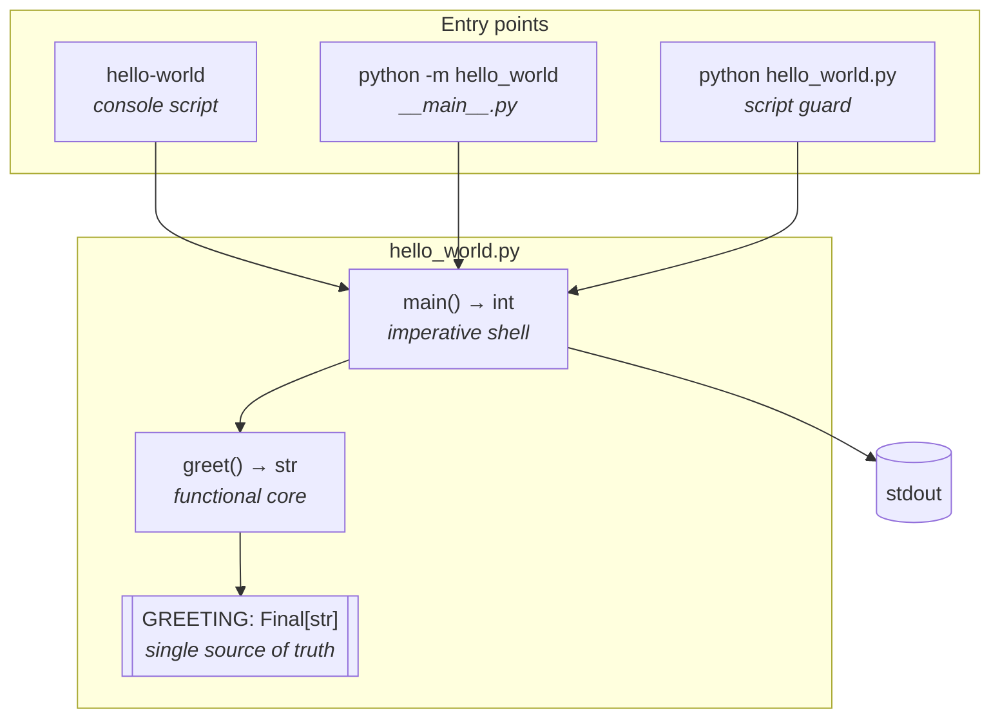
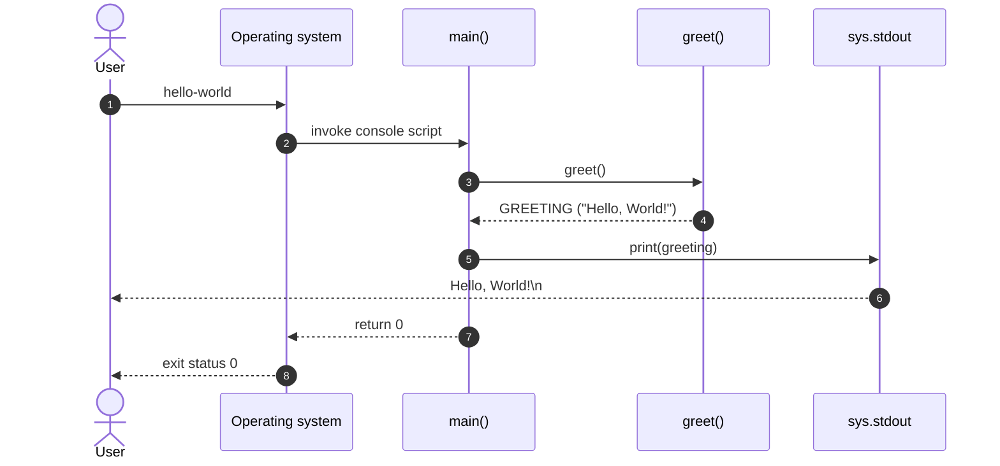

# Architecture

This document describes the architecture of the hello-world application. For the reasoning behind each decision, see the [Architecture Decision Records](adr/).

## Overview

Hello World follows the **functional core, imperative shell** pattern:

- the **functional core** (`greet()`) builds the greeting, without any side effect;
- the **imperative shell** (`main()`) performs the I/O and reports the exit code.

The whole implementation lives in a single module ([ADR-0004](adr/0004-single-module-layout.md)).

## Components

| Component     | Responsibility                                   | Side effects     | ADR                                                                          |
| ------------- | ------------------------------------------------ | ---------------- | ---------------------------------------------------------------------------- |
| `GREETING`    | Holds the canonical greeting                     | None             | [0006](adr/0006-define-the-greeting-as-a-module-level-constant.md)           |
| `greet()`     | Composes the greeting                            | None             | [0003](adr/0003-separate-greeting-composition-from-output.md)                |
| `main()`      | Writes the greeting and returns the exit code    | Writes to stdout | [0003](adr/0003-separate-greeting-composition-from-output.md), [0008](adr/0008-use-print-for-output.md) |
| `__main__.py` | Enables `python -m hello_world`                  | Exits the process | [0004](adr/0004-single-module-layout.md)                                    |
| `__init__.py` | Exposes the public API and the version           | None             | [0004](adr/0004-single-module-layout.md)                                     |

## Execution flow

## Design principles

1. **Purity first.** Everything that can be pure is pure. I/O is confined to a single line of `main()`.
2. **Single source of truth.** The greeting exists exactly once in the codebase.
3. **Byte-exact contract.** The output is a public API. It is pinned down by the conformance test suite, including cryptographic fingerprints.
4. **Hermeticity.** The output does not depend on the environment, the locale, the terminal or the command-line arguments.
5. **Simplicity.** No abstraction is introduced without a documented need (YAGNI).

## Non-functional characteristics

| Characteristic | Guarantee                                   | Verified by                     |
| -------------- | ------------------------------------------- | ------------------------------- |
| Correctness    | Output is exactly `Hello, World!\n`         | `tests/conformance/`            |
| Security       | No terminal injection vector in the output  | `tests/security/`               |
| Performance    | `greet()` under 10 µs, cold start under 2 s | `tests/performance/`            |
| Thread safety  | Safe under concurrent calls                 | `tests/concurrency/`            |
| Portability    | Python 3.10 to 3.13, Linux, macOS, Windows  | CI matrix                       |
